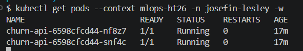
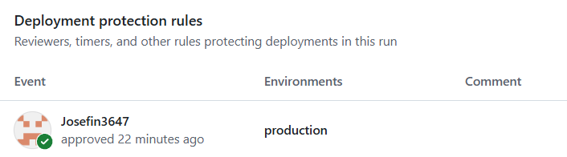
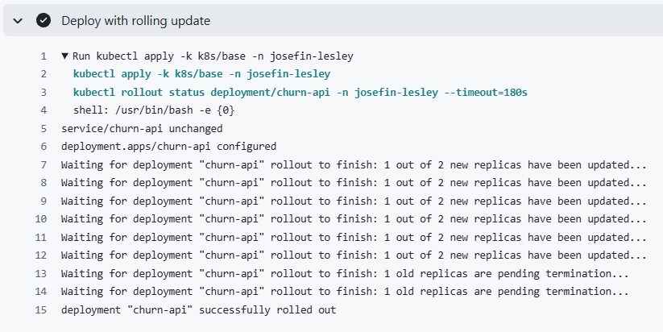

# Utrullning till Kubernetes

## Två miljöer

| Miljö | Roll | Kontext |
|---|---|---|
| kind på min dator | Test | `kind-churn` |
| Klassklustret (k3s på Hetzner, arm64) | Produktion | `mlops-ht26`, namespace `josefin-lesley` |

Båda använder samma manifest i `k8s/base`:

```bash
kubectl apply -k k8s/base --context kind-churn
kubectl apply -k k8s/base --context mlops-ht26 -n josefin-lesley
```

För att tjänsten skulle köra i klassklustret behövde jag:

- **Bygga imagen för arm64.** Klustret kör arm64, så pipelinen bygger nu imagen för både `linux/amd64` och `linux/arm64` under samma tagg.
- **Lägga till `securityContext`.** Klustret kräver Pod Security "restricted": ingen root, inga extra rättigheter och seccomp `RuntimeDefault`.
- **Sänka `requests`** till 80m CPU och 128Mi minne. Namespacets kvot tillåter 250m och 384Mi, och tre poddar (två repliker plus en extra under rolling update) måste få plats.
- **Förnya pull-secreten `ghcr`** med en egen token med `read:packages`.



## Utrullningsstrategi: rolling update

Ringlistan tas fram i en batchkörning varje måndag med en enda modell (`score.py`). API:t (`/predict`) bedömer en kund i taget och måste svara även under en utrullning.

**Varför rolling update:** Med `replicas: 2` och `maxUnavailable: 0` finns alltid två redo poddar. En ny podd får trafik först när `/health` svarar, och `/health` laddar modellen, så en trasig modell rullas aldrig ut. Det är inbyggt i Deployment och kräver inga extra resurser.

**Varför inte canary:** API:t har för lite trafik för att jämföra versioner, och om kunderna lämnar syns först efter veckor.

**Varför inte blue/green:** Dubbla resurser, och fördelen att versioner aldrig blandas behövs inte eftersom listan tas fram i batch.

### Uppdatering

Ny modell (`C = 0,5`, image `6366a78`) rullades ut i kind med `kubectl apply -k`. Varje ny podd blev redo innan en gammal stängdes.


### Tillbakarullning

1. `kubectl rollout undo deployment/churn-api` för att snabbt få tillbaka den tidigare versionen.
2. `git revert` av ändringen av `newTag`, så att Git och klustret stämmer.


## Utrullning från pipelinen

Jobbet `deploy-production` i `.github/workflows/ci.yml` rullar ut till klassklustret:

- **Bara från `main`:** jobbet körs bara vid push eller manuell körning på `main`, aldrig från en PR eller vid schemalagd körning.
- **Godkännande före produktion:** jobbet använder GitHub-miljön `production`, som kräver godkännande av en granskare och bara tillåter branchen `main`.
- **Kubeconfig som secret:** åtkomsten till klustret ligger som secret i miljön `production`, så bara godkända jobb kommer åt den.

Jobbet sätter imagens tagg till commitens SHA med `kustomize edit set image`, kör `kubectl apply -k` och väntar med `kubectl rollout status`. Commit X på `main` rullas alltså ut som image X. Taggen committas inte tillbaka, så `newTag` i `kustomization.yaml` är bara ett startvärde för manuella utrullningar.

En tillbakarullning i produktion görs med `kubectl rollout undo` och sedan `git revert` av commiten som orsakade problemet. Reverten blir en ny commit som pipelinen rullar ut efter godkännande.

Utrullningar till produktion görs helst onsdagar vid lunch: personal finns på plats för tillbakarullning, och nya modeller hinner bevakas innan måndagens ringlista tas fram.




## Plan för drift

| Signal | Upptäcks med | Åtgärd |
|---|---|---|
| Trasig modell | `/health` svarar inte | Utrullningen stannar av sig själv |
| Svaren ändras kraftigt | Fördelningen av sannolikheter jämfört med förra versionen | Larm, tillbakarullning |
| Sämre träffar | Precision@100 efter 90 dagar, per modellversion | Tillbakarullning |
| Ny data skiljer sig | `drift.py` på varje dataleverans | Larm, omträning |

ROC AUC räcker inte, eftersom det bara mäter ordningen mellan kunder. Säljarnas samtal påverkar dessutom utfallet, så vem som ringdes loggas, och en liten kontrollgrupp ringer inte.