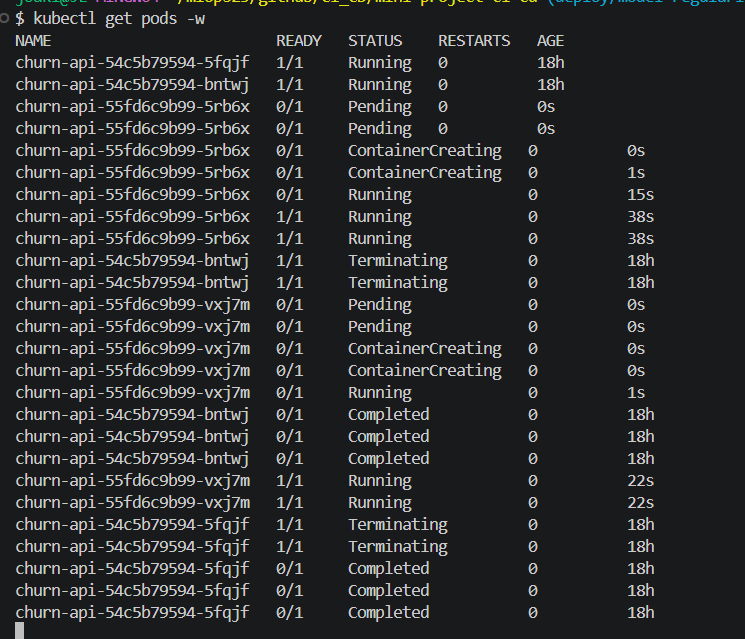
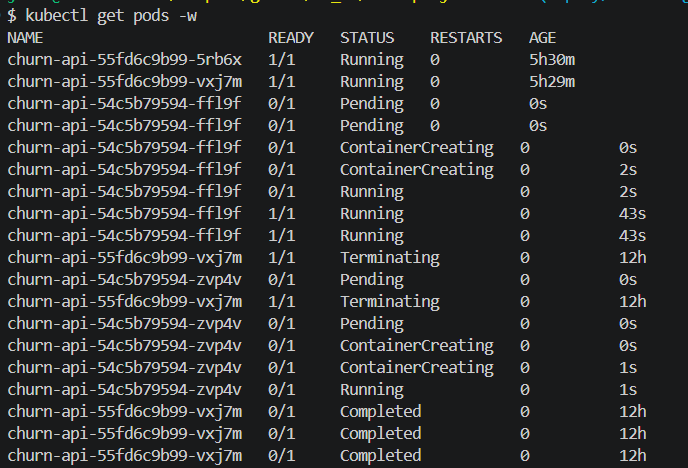
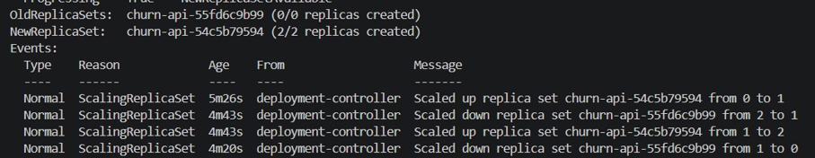

# Utrullning till Kubernetes

## Två miljöer

| Miljö | Roll | Kontext |
|---|---|---|
| kind på min dator | Test | `kind-churn` |
| Klassklustret (k3s på Hetzner, arm64) | Produktion | `mlops-ht26`, namespace `josefin-lesley` |

Båda använder samma manifest i `k8s/base`:

```bash
kubectl apply -k k8s/base --context kind-churn
kubectl apply -k k8s/base --context mlops-ht26 -n josefin-lesley
```

För att tjänsten skulle köra i klassklustret behövde jag:

- **Bygga imagen för arm64.** Klustret kör arm64, så pipelinen bygger nu imagen för både `linux/amd64` och `linux/arm64` under samma tagg.
- **Lägga till `securityContext`.** Klustret kräver Pod Security "restricted": ingen root, inga extra rättigheter och seccomp `RuntimeDefault`.
- **Sänka `requests`** till 80m CPU och 128Mi minne. Namespacets kvot tillåter 250m och 384Mi, och tre poddar (två repliker plus en extra under rolling update) måste få plats.
- **Förnya pull-secreten `ghcr`** med en egen token med `read:packages`.


## Utrullningsstrategi: rolling update

Ringlistan tas fram i en batchkörning varje måndag med en enda modell (`score.py`). API:t (`/predict`) bedömer en kund i taget och måste svara även under en utrullning.

**Varför rolling update:** Med `replicas: 2` och `maxUnavailable: 0` finns alltid två redo poddar. En ny podd får trafik först när `/health` svarar, och `/health` laddar modellen, så en trasig modell rullas aldrig ut. Det är inbyggt i Deployment och kräver inga extra resurser.

**Varför inte canary:** API:t har för lite trafik för att jämföra versioner, och om kunderna lämnar syns först efter veckor.

**Varför inte blue/green:** Dubbla resurser, och fördelen att versioner aldrig blandas behövs inte eftersom listan tas fram i batch.

### Uppdatering

Ny modell (`C = 0,5`, image `6366a78`) rullades ut i kind med `kubectl apply -k`. Varje ny podd blev redo innan en gammal stängdes.



### Tillbakarullning

1. `kubectl rollout undo deployment/churn-api` för att snabbt få tillbaka den tidigare versionen.
2. `git revert` av ändringen av `newTag`, så att Git och klustret stämmer.




## Utrullning från pipelinen

Jobbet `deploy-production` i `.github/workflows/ci.yml` rullar ut till klassklustret:

- **Bara från `main`:** jobbet körs bara vid push eller manuell körning på `main`, aldrig från en PR eller vid schemalagd körning.
- **Godkännande före produktion:** jobbet använder GitHub-miljön `production`, som kräver godkännande av en granskare och bara tillåter branchen `main`.
- **Kubeconfig som secret:** åtkomsten till klustret ligger som secret i miljön `production`, så bara godkända jobb kommer åt den.

Jobbet sätter imagens tagg till commitens SHA med `kustomize edit set image`, kör `kubectl apply -k` och väntar med `kubectl rollout status`. Varje commit på `main` som ändrar kod, data eller manifest byggs som en image med commitens SHA och rullas ut efter godkännande. Taggen committas inte tillbaka, så `newTag` i `kustomization.yaml` är bara ett startvärde för manuella utrullningar.

En tillbakarullning i produktion görs med `kubectl rollout undo` och sedan `git revert` av commiten som orsakade problemet. Reverten blir en ny commit som pipelinen rullar ut efter godkännande.

Utrullningar till produktion görs helst onsdagar vid lunch: personal finns på plats för tillbakarullning, och nya modeller hinner bevakas innan måndagens ringlista tas fram.


## Plan för drift

| Signal | Upptäcks med | Larm | Åtgärd |
|---|---|---|---|
| Trasig modell | `/health` svarar inte, så nya poddar blir aldrig redo | `kubectl rollout status --timeout=180s` misslyckas och `deploy-production` blir rött | Gamla poddar svarar vidare, `git revert` av ändringen |
| Ny data skiljer sig | `drift.py` och Pandera-schemat på varje ny datafil | `validate` blir rött och pipelinen stoppas | Granska datan, träna om när den är godkänd |
| Fel i anrop till API:t | Tillåtna värden för region och abonnemang i Pydantic (`CustomerInput`), ej byggt | API:t svarar 422 | Rätta systemet som anropar |
| Svaren ändras kraftigt | Fördelningen av sannolikheter jämfört med förra versionen, ej byggt | Nytt larm behövs | `git revert` av modelländringen |
| Sämre träffar | Precision@100 efter 90 dagar, per modellversion, ej byggt | Nytt larm behövs | `git revert` före nästa måndag |

**Larm i dag:** ett jobb som blir rött syns i GitHub Actions. GitHub skickar dessutom e-post om misslyckade workflows om det är påslaget under Settings → Notifications → Actions. Det är en inställning i GitHub, inte i koden.

**Tillbakarullning:** `kubectl rollout undo` påverkar bara API:t. Ringlistan tränar sin modell från `main` i pipelinen, så en dålig modell rullas tillbaka med `git revert`, som måste vara på `main` före måndagens körning.

**Förutsättning:** uppföljningen kräver en gemensam MLflow-server. I dag skapas en ny `mlflow.db` i varje körning, och artifacts rensas efter 90 dagar. Varje modell och ringlista bör sparas i samma körning, med commitens SHA, och precision@100 loggas när utfallet är känt.

**Varför ROC AUC inte räcker:** det mäter bara ordningen mellan kunder, inte om sannolikheterna går att använda.

**Återkopplingsloopen:** säljarnas samtal påverkar om kunden stannar. Därför loggas vem som ringdes och vad som erbjöds, och en liten kontrollgrupp ringer inte.

## Användning av AI

Jag har använt en LLM som handledare under arbetet.

**AI har hjälpt till med:**
- att förklara begrepp, till exempel kontexter, Kustomize, utrullningsstrategier, revisioner, `maxSurge`/`maxUnavailable`, regularisering och ROC AUC m.m.
- att föreslå kommandon och kodändringar steg för steg, bland annat `kustomization.yaml`, `securityContext`, bygget för arm64 och jobbet `deploy-production`
- felsökning i klassklustret: PodSecurity, 403 från ghcr, `exec format error` och kvoten
- en kontrollberäkning av modellen med olika värden på `C`
- utkast till texten i det här dokumentet, som jag har granskat och anpassat

**Jag har själv:**
- kört alla kommandon, gjort utrullningarna och kontrollerat resultatet i kind och i klassklustret
- fattat besluten: Kustomize för image-taggen, rolling update, att återgå till `C = 1,0`, att behålla `k8s/base` och tidpunkten för utrullningar
- bidragit med resonemangen om hur ringlistan används, varför canary inte passar, uppföljning av kunderna över tid, återkopplingsloopen, att kundbasen fångar förändringar i kundgruppen, Pydantic-kontrollen och behovet av en MLflow-server